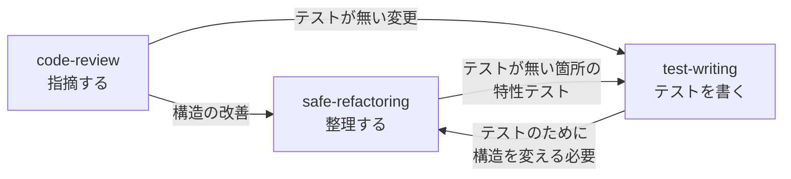

# coding-skills

コーディングエージェント（Claude Code など）が、リファクタリング・コードレビュー・テストの作成を、決まった手順と確認の基準で行うための Skill 集です。

コーディングエージェントは、指示しなくてもこれらの作業をこなします。ただし、放っておくと次のような進め方をしがちです。

- リファクタリングで、複数の変更を一度に行い、テストを実行せずに「振る舞いは変わっていない」と報告する
- コードレビューで、確かめていない指摘や好みだけの指摘を、重要度を揃えずに並べる
- テストで、正常系だけを書いたり、実装の出力をそのまま期待値に写したりして、コードを壊しても落ちないテストを作る

この Skill 集は、そうした進め方を防ぐ手順と確認の基準を、エージェントに渡します。

## 含まれる Skill

| Skill | 使う場面 | エージェントが行うこと |
|---|---|---|
| [safe-refactoring](safe-refactoring/SKILL.md) | 振る舞いを変えずにコードを整理するとき | 変更の前後でテストを実行し、操作を 1 回に 1 つだけ適用します。テストが落ちたら変更を戻します。振る舞いが変わりうる操作（`\|\|` から `??` への置き換えなど）は、適用前に利用者に確認します |
| [code-review](code-review/SKILL.md) | 差分・PR・ファイルをレビューするとき | 変更の意図をまとめてから、観点ごとに読みます。確かめた指摘だけを Conventional Comments の形式で並べ、承認できるかの判定を返します。コードは書き換えません |
| [test-writing](test-writing/SKILL.md) | 自動テストを書くとき | テストケースを設計技法で先に表にしてから書きます。書いたテストが、コードを壊したときに落ちることと、繰り返し実行しても結果が変わらないことを確かめます |

3 つの Skill は、互いに作業を引き継ぎます。



## 対象とする技術

手順の大半は言語に依存しません。言語とフレームワークに固有の注意点は、次の技術について書いています。

- TypeScript / JavaScript
- Angular（RxJS、NgRx を含む）
- Svelte 5 / SvelteKit
- MCP サーバー（TypeScript SDK）
- Python、C#（safe-refactoring の言語別の操作のみ）

## 使い方

### Claude Code で使う

リポジトリを取得し、使いたい Skill のディレクトリを `~/.claude/skills/` に置きます。

```bash
git clone https://github.com/shuji-bonji/coding-skills.git
cd coding-skills

# すべてのプロジェクトで使う場合
mkdir -p ~/.claude/skills
ln -s "$(pwd)/safe-refactoring" ~/.claude/skills/safe-refactoring
ln -s "$(pwd)/code-review" ~/.claude/skills/code-review
ln -s "$(pwd)/test-writing" ~/.claude/skills/test-writing
```

特定のプロジェクトだけで使う場合は、そのプロジェクトの `.claude/skills/` に置きます。シンボリックリンクにしておくと、このリポジトリを `git pull` で更新したときに、どのプロジェクトにも反映されます。

### 依頼の例

Skill は、依頼の内容に合わせて自動で読み込まれます。

| 依頼 | 読み込まれる Skill |
|---|---|
| 「この関数を分割して」「any を消して」「重複をまとめて」 | safe-refactoring |
| 「この PR をレビューして」「マージ前にチェックして」 | code-review |
| 「このサービスにテストを書いて」「このバグの再現テストを書いて」 | test-writing |

## 各プロジェクトで用意するとよいもの

Skill は、プロジェクトの次の情報を読んで作業します。用意しておくと、結果がプロジェクトに合ったものになります。

- **`CLAUDE.md`:** テスト・型チェック・lint の実行コマンドと、linter で判定できない取り決め（ディレクトリ構成、層の間の依存の規則、命名）を書きます。code-review は、`CLAUDE.md` に明記された規則に反する点を指摘します。
- **linter と formatter の設定:** 書式や機械で判定できる規則は、Skill ではなく ESLint・Prettier などに任せます。code-review は、ツールで見つかる問題を指摘しません。
- **MCP サーバー（任意）:** 版によって変わる推奨は、公式の MCP サーバーがあればそちらを参照します。Angular CLI の MCP サーバー、Svelte の MCP サーバー、rxjs-mcp に対応しています。

## このリポジトリに含めていないもの

- **コーディング全般の Skill:** エージェントはもともとコードを書けるため、手順を足さない一般論の Skill は出力を変えません。
- **言語やフレームワークごとの Skill:** 現行の書き方は公式の MCP サーバーやドキュメントに任せ、案件ごとの取り決めは各プロジェクトの `CLAUDE.md` に書く方針です。
- **負荷テスト・脆弱性診断・ユーザビリティテストなど:** 専用のツールや実際の利用者が必要なため、test-writing の対象外としています。

## 参考にした資料

- Martin Fowler『リファクタリング』（第 2 版）
- Google Engineering Practices — Code Review Developer Guide: https://google.github.io/eng-practices/review/（CC BY 3.0）
- Conventional Comments: https://conventionalcomments.org/
- OWASP Code Review Guide: https://owasp.org/www-project-code-review-guide/
- SmartBear, Best Practices for Code Review: https://smartbear.com/learn/code-review/best-practices-for-peer-code-review/
- Bacchelli & Bird, Expectations, Outcomes, and Challenges of Modern Code Review（ICSE 2013）
- Claude Code 公式 code-review プラグイン
- Google Testing Blog: https://testing.googleblog.com/
- Titus Winters ほか『Software Engineering at Google』
- Gerard Meszaros『xUnit Test Patterns』
- ISTQB Certified Tester Foundation Level シラバス v4.0
- Testing Library: Guiding Principles: https://testing-library.com/docs/guiding-principles/
- Svelte のドキュメント: https://svelte.dev/docs
